> Language: **English** | [日本語](./docs/jp/README.md)

# agent-ready-app-template

An **agent-ready** full-stack cloud web & desktop application template (**Light** `<$10/month` & **Standard** Rust Connect RPC + PostgreSQL 18 RLS) built around **Svelte 5 + SvelteKit 3** and **Tauri** — designed so AI coding agents skip repetitive architecture boilerplate and spend tokens on your product.

> **Status:** Both **Light** (Cloud Run v2 + Cloud Firestore) and **Standard** (Cloud Run v2 BFF + internal Rust Connect RPC API + Cloud SQL PostgreSQL 18 + Direct VPC Egress + Private Cloud DNS + RLS) architectures are implemented and verified end-to-end on Google Cloud, along with `bun run init` to specialize a new repository into either variant. See [CHANGELOG.md](./CHANGELOG.md).

---

## Why This Template? (Concept)

Asking an AI coding agent to build an application from scratch often burns tokens and time on repeated **architecture design -> scaffolding -> auth/security fixes -> IaC debugging** loops before any actual product feature exists.

**agent-ready-app-template** flips that workflow:

1. **Skip boilerplate, spend tokens on features:** Start from a live-verified baseline that already solves Google OAuth, allowlist authorization, security headers (CSP/HSTS), PostgreSQL Row-Level Security, distroless containers, Terraform IaC, and keyless WIF CI/CD.
2. **Built for AI coding agents from day one:** Ships with explicit guardrails (`AGENTS.md`, `GEMINI.md`), OKF v0.3 Architecture Decision Records (`docs/adr/`), bundled Svelte 5 / `shadcn-svelte` skills (`web-app/app/.agents/skills/`), and a cleanly layered 3-part BFF (`src/lib/server/`) so agents can extend or customize safely without architectural drift.
3. **Pick Light or Standard, then customize freely:** If the **Light** (`<$10/month`, scale-to-zero) or **Standard** (Rust API + PostgreSQL 18 RLS) setup fits your project, run `bun run init` to lock in that variant, drop unused scaffolding, and customize freely from there.

---

## Quick Start

### Option A: Add to an Existing Repository (`bunx` — No Clone Required)

Run directly from the root of an existing (or empty) repository to place `web-app`, `desktop`, or `both` without overwriting existing files by default:

```bash
# Interactive mode (prompts for target, variant, app slug, and optional CI/docs)
bunx github:theta-mynd/agent-ready-app-template

# Preview additions and file conflicts without modifying anything
bunx github:theta-mynd/agent-ready-app-template --target=web-app --variant=light --name=my-app --dry-run

# Place web-app only (Light) into the current repository
bunx github:theta-mynd/agent-ready-app-template --target=web-app --variant=light --name=my-app --yes

# Place the Tauri desktop wrapper only
bunx github:theta-mynd/agent-ready-app-template --target=desktop --name=my-app --yes

# Place both web-app (Standard) and desktop, plus matching CI/deploy workflows
bunx github:theta-mynd/agent-ready-app-template --target=both --variant=standard --name=my-saas --with-ci --yes
```

Key behaviors for existing repositories:
- **Safe conflict handling:** Existing files (such as `compose.yaml`) are skipped by default and listed in the summary; pass `--force` only if you want to overwrite them.
- **Opt-in root extras:** `.github/workflows/*` + `.gitleaks.toml` (`--with-ci`) and `AGENTS.md` / `GEMINI.md` / `docs/` (`--with-docs`) are only copied when explicitly requested.
- **Pin a version or branch:** Append `#vX.Y.Z` (or `#<branch>`) to `github:theta-mynd/agent-ready-app-template`.

### Option B: Create a New Repository from This Template (`bun run init`)

After creating a repository from this template, run `bun run init` from the repository root to lock the project to **Light** or **Standard**:

```bash
# Interactive mode (prompts for variant, optional app slug, and options)
bun run init

# Preview changes without modifying files
bun run init -- --variant=standard --name=my-saas-app --dry-run

# Initialize as Standard (removes Light Firestore BFF code & promotes web-app/infra/gcp/standard/)
bun run init -- --variant=standard --name=my-saas-app --yes

# Initialize as Light (removes Standard BFF code, pg/ConnectRPC deps, web-app/api/, proto/)
bun run init -- --variant=light --name=my-lean-app --yes

# Initialize as Light while keeping web-app/api/ & proto/ as reference examples
bun run init -- --variant=light --keep-api --yes
```

What `bun run init` does for each variant:

| Area | `--variant=light` (GCP) | `--variant=standard` (GCP) |
| --- | --- | --- |
| **BFF (`web-app/app/src/lib/server/`)** | Keeps `light/gcp/firestore.ts`; removes `standard/` & `src/lib/gen/`; locks `backend.ts` to Light | Keeps `standard/` (Better Auth `auth` schema pool + Connect RPC client); removes `light/` (zero direct datastore CRUD from BFF); locks `backend.ts` to Standard |
| **Dependencies (`web-app/app/package.json`)** | Removes `pg`, `@types/pg`, `@connectrpc/*`, `@bufbuild/*` | Removes `@google-cloud/firestore` |
| **Rust API & Proto** | Removes `web-app/api/`, `proto/`, `buf*.yaml`, `rust-api-ci.yml` (retained if `--keep-api`) | Kept |
| **Local Compose (`compose.yaml`)** | Firestore Emulator only | PostgreSQL 18 default (`docker compose up -d`) |
| **Terraform (`web-app/infra/gcp/`)** | Promotes `light/` → `web-app/infra/gcp/` | Promotes `standard/` → `web-app/infra/gcp/` |
| **CI/CD (`.github/workflows/`)** | Removes `deploy-gcp-standard.yml`; simplifies `terraform-validate.yml` | Removes `deploy-gcp.yml`; simplifies `terraform-validate.yml` |
| **Rename (`--name=<slug>`)** | Updates package names, Tauri `productName` / `identifier` / deep-link scheme, Terraform `service_name`, and deploy workflow defaults | Same + `web-app/api/Cargo.toml` crate name |

> **Cloud extensibility:** In Standard mode, `web-app -> BFF -> Rust API -> PostgreSQL` is identical across GCP, AWS, and Azure (only the internal service-to-service IAM helper such as `standard/gcp-id-token.ts` differs). In Light mode, datastore & auth session choices vary by cloud (`light/gcp/firestore.ts` uses Stateless JWE Cookies + Firestore; future `light/aws/` can plug in PostgreSQL DB sessions + Aurora DSQL behind the same `BackendAdapter` interface).

---

## Architecture Variants

### 1. Light Architecture (Primary Default — `<$10/month`, Scale-to-Zero)



- **Cost target:** **<$10/month** (typically **$0–$5/month**, idle **$0/month**) with `min_instance_count = 0` and zero always-on fixed-cost resources
- **Compute (`web-app/app`):** Cloud Run v2 single container (`asia-northeast1`, `min_instance_count = 0`, 1 vCPU / 512 MiB, `*.run.app`) running Svelte 5 + SvelteKit 3 (`adapter-bun`) on a hardened **distroless** image
- **UI:** `shadcn-svelte` (Home: `sidebar-07`, Login: `login-03`) with `mode-watcher` (`light` / `dark` / `system`) + bundled `shadcn-svelte` and official Svelte skills under `web-app/app/.agents/skills/`
- **Authentication:** `better-auth` in **Stateless Cookie** mode + **Google OAuth 2.0 only** (`openid`, `email`, `profile`, `$0`), with optional env-based user/domain allowlist and an E2E-only password login toggle (`ENABLE_E2E_PASSWORD_AUTH=false` in production)
- **Datastore:** **Cloud Firestore (Standard Edition, Native Mode)** within the Always Free daily tier, accessed server-side only via the Cloud Run runtime service account (local dev uses the official Firestore Emulator via `compose.yaml`)
- **Desktop (`desktop`):** Tauri wrapper around `web-app/app` (delegates Google OAuth to the OS browser and returns via Deep Link)
- **Infra & Guardrails (`web-app/infra/gcp/light`):** Terraform for Cloud Run v2, Firestore, Artifact Registry (cleanup policy), Secret Manager, Workload Identity Federation (OIDC), Cloud Logging, and Cloud Billing Budget alerts (`$5` / `$8` / `$10`)
- **Design Docs:** [gcp/light-architecture.drawio](./docs/architecture/gcp/light-architecture.drawio) | [Architecture Diagrams](./docs/architecture/README.md) | [ADRs (OKF v0.3)](./docs/adr/index.md) | [ADR-0001](./docs/adr/0001-light-architecture.md)

### 2. Standard Architecture (Dedicated Backend API + PostgreSQL 18 RLS)


For workloads requiring a dedicated backend API and relational database with Row-Level Security (RLS):

- **BFF (`web-app/app`):** Svelte 5 + SvelteKit 3 with Better Auth DB sessions in PostgreSQL (`auth` schema) and Connect RPC client (`src/lib/server/standard/`) forwarding short-lived HS256 `x-app-user-token` + GCP OIDC ID tokens to the internal API
- **Backend API (`web-app/api`):** Rust (`Connect RPC + Axum + sqlx + PostgreSQL 18 RLS`) on internal-only Cloud Run v2 (`INGRESS_TRAFFIC_INTERNAL_ONLY` + Cloud Run IAM) + `--migrate-only` Cloud Run Job
- **Database:** Cloud SQL for PostgreSQL 18 (Private IP only + Direct VPC Egress `$0`; note: Cloud SQL has no native scale-to-zero and typically costs `~$10–$15+/month` minimum, which is why **Light** is recommended for `<$10/month`)
- **Infra (`web-app/infra/gcp/standard`):** Terraform for Custom VPC + Private Services Access + Private Cloud DNS (`run.app.` -> `private.googleapis.com`), Cloud SQL for PostgreSQL 18 (Private IP only), Cloud Run v2 (`app`, internal `api`, and `migrate` Job via Direct VPC Egress), least-privilege SAs, Secret Manager, WIF (OIDC), and Cloud Billing Budget alerts (`$10` / `$15` / `$20`)
- **Design Docs:** [gcp/standard-architecture.drawio](./docs/architecture/gcp/standard-architecture.drawio) | [Architecture Diagrams](./docs/architecture/README.md) | [ADR-0002](./docs/adr/0002-standard-architecture.md)
- **Multi-cloud roadmap:** Future `web-app/infra/aws` (AWS CDK, [#54](https://github.com/theta-mynd/agent-ready-app-template/issues/54)) and `web-app/infra/azure` (Azure Bicep, [#55](https://github.com/theta-mynd/agent-ready-app-template/issues/55))

---

## Directory Structure

```text
agent-ready-app-template/
├── .github/
│   ├── ISSUE_TEMPLATE/        # Bug & feature request forms (Issues-only workflow)
│   ├── workflows/             # CI (Web App, Rust API, Terraform Validate, Gitleaks) & GCP Deploy
│   ├── CONTRIBUTING.md
│   ├── dependabot.yml
│   └── release.yml
├── compose/
│   └── postgres/              # Local PostgreSQL 18 init script (auth/app schemas & RLS roles)
├── docs/
│   ├── adr/                   # OKF v0.3 Architecture Decision Records (English canonical)
│   ├── architecture/          # .drawio / .drawio.svg architecture diagrams
│   └── jp/                    # Synchronized Japanese documentation mirrors
├── proto/                     # Buf v2 Protobuf definitions (TenantService, TodoService)
├── scripts/
│   ├── init.ts                # Template initializer (`bun run init`) for Light vs Standard
│   ├── init.test.ts           # End-to-end tests for `bun run init` (`bun run test:init`)
│   ├── scaffold.ts            # `bunx` scaffold CLI for existing repositories (web-app / desktop / both)
│   └── scaffold.test.ts       # Tests for `scripts/scaffold.ts` (`bun run test:scaffold`)
├── web-app/
│   ├── api/                   # Rust Connect RPC + Axum + sqlx + PostgreSQL 18 RLS API (Standard)
│   ├── app/                   # Svelte 5 + SvelteKit 3 (adapter-bun) + shadcn-svelte + better-auth
│   │   └── src/lib/server/    # Core facade (backend.ts, auth.ts) + light/gcp/ + standard/
│   └── infra/
│       ├── gcp/               # Terraform (light/ and standard/ root modules)
│       │   ├── light/         # Scale-to-zero Cloud Run v2 + Firestore (<$10/month)
│       │   └── standard/      # Cloud Run v2 (app/api/migrate) + VPC + Cloud SQL PG 18
│       ├── aws/               # Placeholder for future AWS CDK (#54)
│       └── azure/             # Placeholder for future Azure Bicep (#55)
├── desktop/                   # Tauri desktop wrapper
├── AGENTS.md                  # Shared repository rules & release policy for AI agents
├── CHANGELOG.md               # Release history (Keep a Changelog)
├── GEMINI.md                  # Antigravity / Gemini workspace rules (includes AGENTS.md)
├── compose.yaml               # Local Firestore Emulator (default) & PostgreSQL 18 (`standard` profile)
├── package.json               # Root CLI bin (`bunx`) & scripts (`init`, `scaffold`, `test:init`, `test:scaffold`)
├── .gitleaks.toml
├── .gitignore
├── LICENSE                    # MIT License
└── README.md
```

---

## Documentation Language Policy

- **English** is the canonical language for all documentation, ADRs, diagrams, and agent rules.
- Synchronized **Japanese mirrors** for key human-facing docs live under [`docs/jp/`](./docs/jp/README.md). See [AGENTS.md](./AGENTS.md) for contributor and agent rules.

---

## Security & Secret Handling

This is a **public template repository**. Never commit real credentials or environment-specific state:

- Only commit `*.example` files (`.env.example`, `terraform.tfvars.example`) with dummy placeholder values (`CHANGE_ME`).
- Real `.env*`, `*.tfvars`, `*.tfstate*`, `*.pem`, `*.key`, and service account JSON files are blocked via `.gitignore`.
- CI authentication to Google Cloud uses **Workload Identity Federation (OIDC)** instead of long-lived JSON service account keys.
- All commits to `main` are scanned with **Gitleaks** (`.github/workflows/secret-scan.yml`).

---

## Issues & License

- **Feedback / Questions:** Please open an Issue using the provided templates (pull requests from external forks are not accepted; see [.github/CONTRIBUTING.md](.github/CONTRIBUTING.md)).
- **License:** [MIT](LICENSE)
