> Language: **English** | [日本語](../jp/architecture/README.md)

# Architecture Diagrams

This directory stores architecture diagrams (`.drawio` / `.drawio.svg`).
Architecture Decision Records (ADRs) are maintained in [../adr/index.md](../adr/index.md) using the Open Knowledge Format (OKF) v0.3 bundle format.

## Light Architecture (Current Focus)

- **Editable Diagram:** [light-architecture.drawio](./light-architecture.drawio)
- **ADR (OKF v0.3):** [ADR-0001: Light Architecture Design](../adr/0001-light-architecture.md)
- **Summary:** `<$10/month`, Cloud Run v2 (`min_instance_count = 0`, `asia-northeast1`), single-container Svelte 5 + SvelteKit 3 (`adapter-bun`, distroless, `shadcn-svelte` `sidebar-07` / `login-03`), `better-auth` Stateless Cookie + Google OAuth only (with env-based Allowlist & E2E toggle), Cloud Firestore Standard (Always Free tier), and Tauri desktop wrapper (OS browser + Deep Link OAuth).

## Standard Architecture (Future Roadmap)

- Tracked in [Issue #2](https://github.com/theta-myd/lean-cloud-app-template/issues/2): SvelteKit BFF + Rust API (`Connect RPC + Axum + sqlx + RLS`) + PostgreSQL.
