> 言語: [English](../../README.md) | **日本語**

# lean-cloud-app-template

**Svelte 5 + SvelteKit 3** と **Tauri** をベースにした、**月額 $10 未満**・**Scale-to-Zero（`min-instance = 0`）** 志向の Cloud Run Web & デスクトップアプリテンプレートです。

> **ステータス:** Light 構成のアーキテクチャ設計・OKF v0.3 ADR・GCP Terraform IaC（`web-app/infra/gcp/`）まで整備済み。次のステップはアプリケーション雛形（`web-app/app/`、`desktop/`）の構築です。

---

## コンセプト & コスト目標

- **目標月額コスト:** **月額 $10 未満**（小規模運用で **$0〜$5/月**、アイドル時は **$0/月**）
- **Scale-to-Zero 徹底:** Cloud Run は `min_instance_count = 0` とし、常時課金が発生するサービス（Cloud SQL・Cloud Load Balancing 等）を排除
- **単一リポジトリ構成:** まずは単一コンテナの **Light** 構成を磨きつつ、将来の **Standard** 構成（Rust API + PostgreSQL）へ拡張できる構成を維持

---

## アーキテクチャ構成

### 1. Light 構成（現在の注力対象）



- **Compute (`web-app/app`):** Cloud Run v2 単一コンテナ（`asia-northeast1`、`min_instance_count = 0`、1 vCPU / 512 MiB、`*.run.app`）上で Svelte 5 + SvelteKit 3（`adapter-bun`）＋ **distroless** イメージを稼働
- **UI:** `shadcn-svelte`（Home: `sidebar-07` / Login: `login-03`）＋ `web-app/app/` 配下に `shadcn-svelte` スキルを配置予定
- **認証:** `better-auth`（**Stateless Cookie モード**）＋ **Google OAuth 2.0 のみ**（`openid`, `email`, `profile`、$0）。環境変数ベースの Allowlist 認可と、E2E テスト専用のパスワードログイン切替（本番は `ENABLE_E2E_PASSWORD_AUTH=false` 固定）に対応
- **データストア:** **Cloud Firestore（Standard Edition, Native Mode）** を永年無料枠内で利用。Cloud Run ランタイム SA 経由のサーバーサイド専用アクセスとし、ローカル開発では `compose.yaml` で公式 Firestore Emulator を使用
- **Desktop (`desktop`):** `web-app/app` をラップする Tauri アプリ（Google OAuth は OS 標準ブラウザへ委譲し Deep Link で復帰）
- **Infra & 安全装置 (`web-app/infra/gcp`):** Terraform により Cloud Run v2、Firestore、Artifact Registry（Cleanup Policy 付き）、Secret Manager、Workload Identity Federation（OIDC）、Cloud Logging、Cloud Billing Budget アラート（`$5` / `$8` / `$10`）を構築
- **設計ドキュメント:** [light-architecture.drawio](../architecture/light-architecture.drawio) | [構成図 README](./architecture/README.md) | [ADR 一覧 (OKF v0.3 正本)](../adr/index.md) | [ADR-0001 (日本語)](./adr/0001-light-architecture.md)

### 2. Standard 構成（将来ロードマップ）

専用のバックエンド API や PostgreSQL の Row-Level Security（RLS）が必要な案件向けに [Issue #2](https://github.com/theta-myd/lean-cloud-app-template/issues/2) で管理：

- **Backend API (`web-app/api`):** Rust（`Connect RPC + Axum + sqlx + RLS`）
- **Database:** PostgreSQL（※Cloud SQL は Scale-to-Zero 非対応で最小構成でも約 $10〜$15+/月かかるため、まず **Light** 構成を優先）
- **マルチクラウド & 切替:** 将来の `web-app/infra/aws`（AWS CDK）、`web-app/infra/azure`（Bicep）、および `bun run init` による `light` / `standard` 切替機構

---

## ディレクトリ構成

```text
lean-cloud-app-template/
├── .github/
│   ├── ISSUE_TEMPLATE/        # Bug / Feature Issue テンプレート（Issue のみ受付）
│   ├── workflows/             # Gitleaks 秘密情報スキャン & Terraform 検証 CI
│   ├── CONTRIBUTING.md
│   └── dependabot.yml
├── docs/
│   ├── adr/                   # OKF v0.3 準拠 ADR（英語正本）
│   ├── architecture/          # .drawio / .drawio.svg アーキテクチャ図
│   └── jp/                    # 主要人間向けドキュメントの日本語ミラー
├── web-app/
│   ├── app/                   # Svelte 5 + SvelteKit 3 (adapter-bun) + shadcn-svelte + better-auth
│   └── infra/
│       ├── gcp/               # Terraform（優先ターゲット）
│       ├── aws/               # 将来の AWS CDK 用プレースホルダ
│       └── azure/             # 将来の Azure Bicep 用プレースホルダ
├── desktop/                   # Tauri デスクトップラッパー
├── AGENTS.md                  # AI エージェント共通リポジトリルール
├── GEMINI.md                  # Antigravity / Gemini 用ルール（AGENTS.md を読込）
├── compose.yaml               # ローカル開発用 Firestore Emulator
├── .gitleaks.toml
├── .gitignore
├── LICENSE                    # MIT License
└── README.md
```

---

## ドキュメント言語ポリシー

- 本リポジトリの正本（Canonical）は **英語** です。
- 主要な人間向けドキュメント（`README.md`, `docs/adr/NNNN-*.md`, `docs/architecture/README.md`）のみ `docs/jp/` 配下に日本語ミラーを同期維持します。詳細は [AGENTS.md](../../AGENTS.md) および [GEMINI.md](../../GEMINI.md) を参照してください。

---

## セキュリティ & 秘密情報の取り扱い

本リポジトリは **Public テンプレート** です。実際の認証情報や環境固有のステートは絶対に含めないでください。

- コミット対象は `*.example`（`.env.example`, `terraform.tfvars.example`）のみとし、ダミー値（`CHANGE_ME` 等）を記載します。
- 実 `.env*`, `*.tfvars`, `*.tfstate*`, `*.pem`, `*.key`, サービスアカウント JSON 等は `.gitignore` で除外しています。
- CI から Google Cloud への認証は鍵ファイルを使わず **Workload Identity Federation（OIDC）** を利用します。
- `main` への全コミットは **Gitleaks**（`.github/workflows/secret-scan.yml`）でスキャンされます。

---

## Issue & ライセンス

- **フィードバック / バグ報告:** 用意された Issue テンプレートから起票してください（外部フォークからの PR は受け付けていません。詳細は [.github/CONTRIBUTING.md](../../.github/CONTRIBUTING.md)）。
- **ライセンス:** [MIT](../../LICENSE)
