> 言語: [English](../../architecture/README.md) | **日本語**

# アーキテクチャ図

このディレクトリ（`docs/architecture/`）にはクラウドプロバイダ別（`gcp/`、将来的に `aws/`・`azure/`）のアーキテクチャ構成図（`.drawio` / `.drawio.svg`）を格納しています。
アーキテクチャ決定記録（ADR）の英語正本は Open Knowledge Format (OKF) v0.3 バンドルとして [../../adr/index.md](../../adr/index.md) で管理し、日本語訳を `docs/jp/adr/` に配置しています。

## Google Cloud（`gcp/`）

### Light 構成

- **編集可能な構成図:** [gcp/light-architecture.drawio](../../architecture/gcp/light-architecture.drawio)
- **ADR（日本語ミラー）:** [ADR-0001: Light 構成アーキテクチャ設計](../adr/0001-light-architecture.md)
- **概要:** 月額 `$10` 未満、Cloud Run v2（`min_instance_count = 0`, `asia-northeast1`）、Svelte 5 + SvelteKit 3 単一コンテナ（`adapter-bun`、distroless、`shadcn-svelte` `sidebar-07` / `login-03`）、`better-auth` Stateless Cookie + Google OAuth のみ（環境変数ベース Allowlist & E2E 切替対応）、Cloud Firestore Standard（永年無料枠）、Tauri デスクトップラッパー（OS ブラウザ + Deep Link OAuth）。

### Standard 構成（段階的に実装中）

- **編集可能な構成図:** [gcp/standard-architecture.drawio](../../architecture/gcp/standard-architecture.drawio)
- **ロードマップ管理:** [Issue #2](https://github.com/theta-myd/agent-ready-app-template/issues/2)（サブ Issue #30〜#38）
- **概要:** 月額目安 `$12〜$20`、Cloud Run v2（`min_instance_count = 0`, `asia-northeast1`）+ **Direct VPC Egress（コンピュート・同一リージョン転送 `$0`）**、2 サービス構成（公開 HTTPS の `web-app/app` SvelteKit BFF + **`INGRESS_TRAFFIC_INTERNAL_ONLY`** かつ Cloud Run IAM `roles/run.invoker` で保護された `web-app/api` Rust Connect RPC / Axum / `sqlx`）、**Better Auth PostgreSQL DB セッション**（`auth` スキーマ / `auth_user`、HttpOnly Cookie + 即時失効対応）、**Cloud SQL for PostgreSQL**（Enterprise `db-f1-micro` Zonal、Private Services Access による **Private IP 専用**）、テナント単位の **PostgreSQL `ENABLE & FORCE ROW LEVEL SECURITY`**（`app_user` `NOBYPASSRLS`、署名付き `x-app-user-token` 検証＋`tenant_memberships` 所属確認）、および `sqlx` マイグレーション用 Cloud Run Job。

## AWS / Azure（`aws/`, `azure/` — 将来予定）

- `web-app/infra/aws/`（AWS CDK）・`web-app/infra/azure/`（Azure Bicep）に対応するマルチクラウド構成図は [Issue #2](https://github.com/theta-myd/agent-ready-app-template/issues/2) で将来ロードマップとして管理しています。
